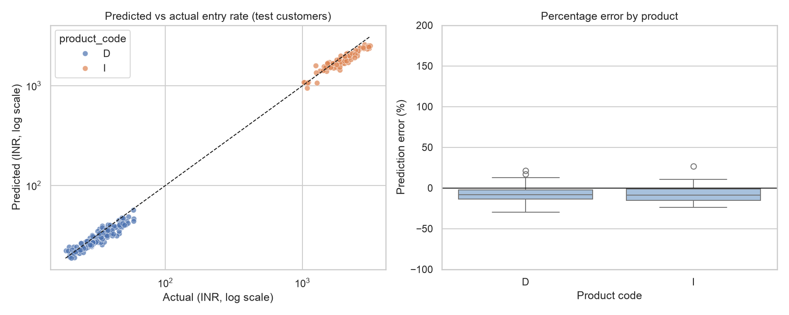

# Can a rate card's structure predict its price?

A capstone project built around Rate Simulator Pro, a pricing tool for testing changes to courier contract rates. The data in this repository is **synthetic**: it copies the layout of a real rate-card export but contains no real customer or price.

**Notebooks, in reading order**

1. [01_data_cleaning.ipynb](notebooks/01_data_cleaning.ipynb)
2. [02_exploratory_analysis.ipynb](notebooks/02_exploratory_analysis.ipynb)
3. [03_modelling.ipynb](notebooks/03_modelling.ipynb)
4. [04_findings_and_recommendations.ipynb](notebooks/04_findings_and_recommendations.ipynb)

## The problem

Every large courier customer has a negotiated rate card: a price for each origin-to-destination lane and weight band. A pricing analyst reviewing one at renewal time has no quick way to tell whether a given lane is priced like similar lanes elsewhere or is an oddity that deserves a conversation.

So the question I wanted to answer is simple. If you know only how a rate card is built (product, region, route type, zones, weight rules), how close can you get to the price on its first weight slab? A decent answer would give analysts a "does this look normal?" check before a renewal.

## The data

The table holds 1,296 simulated lanes across 54 contracts and 8 fictional customers, with effective dates from September 2024 to May 2026. Each row is one lane on one contract, described by its product code, lead region, freight type, origin and destination zone, minimum weight, number of weight slabs and a few other card settings.

I generated it with `src/generate_synthetic_data.py`, using a recipe I wrote down: each product has a base price, and region, zone, customer and contract effects nudge it up or down, plus a little noise. I chose this route because real rate cards name customers and carry negotiated prices that shouldn't be published. The cost is that scores here show the method works. They don't tell you how accurate it would be on real contracts.

## What I did

- **Cleaned** the table, checked ranges and documented every decision (notebook 01).
- **Explored** the price distribution, compared groups and ran rank-based statistical tests (notebook 02).
- **Modelled** the log of the entry price with four models: a median baseline, ridge regression, random forest and gradient boosting. The three real models were tuned with grid search (notebook 03).
- **Validated honestly.** Lanes from one customer look alike, so every split keeps a whole customer on one side. The score I trust most is leave-one-customer-out cross-validation.
- **Judged by** the mean absolute error of the log price, which reads as "typically off by this percentage" and treats a miss on a INR 30 lane as seriously as a miss on a INR 3,000 lane.

## What I found

**Product matters most.** Lanes on product `I` cost about 56 times what the other products cost at the entry slab. Region matters too: even with product `I` set aside, NORTH, EAST and SOUTH2 sit above WEST1 and SOUTH1.

**The model works.** On two customers it had never seen, ridge regression was typically about 9% off the true price (median), against 39% for a flat median guess. Cross-validating across all customers gives a typical error of roughly 21%, and it moves from one held-out customer to the next, so I would quote 10 to 20% as a fair range.

**Simple won.** The plain ridge regression beat random forest and gradient boosting. That makes sense here, because prices in this data move by steady percentages that a straight line on the log scale captures. A fancier model only earns its keep when the pattern has twists.

**A careless split would have flattered the model.** Scoring a random forest with a random split of lanes gave an error of 0.11 on the log scale. Holding out whole customers gave 0.27, more than twice as large. The random split looked better only because the model had already seen each customer.

| Model | Cross-validated log error after tuning (lower is better) |
|---|---|
| Ridge regression | 0.19 |
| Gradient boosting | 0.24 |
| Random forest | 0.27 |
| Median baseline | 1.45 |



## What to do with it

1. Run lanes through the model at renewal time and look at those that sit more than 25% away from the prediction. Treat a flag as a question to ask, not as a price.
2. Don't use it for products with few lanes (`A`, and especially `V` with 16 lanes from one customer). It has hardly seen them.
3. Collect more customers. Eight is too few, and one of them supplies close to half the lanes.
4. Re-run the notebooks on real rate cards inside the company, where customer prices stay protected. Expect lower accuracy than shown here.
5. Add distance, shipment volume and competitor rates. The competitor rate cards gathered for Rate Simulator are the obvious next input.

## Limits

The data is simulated, so accuracy on real contracts is untested. The model predicts only the first weight slab, not a full shipment cost. Two test customers is a small sample, so treat the test score as one data point. Real pricing is also shaped by negotiation, which a table of card attributes can explain only in part.

## Next steps

Run the notebooks on real rate cards behind the company firewall, extend the target to a full-shipment cost for a standard weight, test competitor rates as extra inputs, and show the "differs from similar contracts" flag inside Rate Simulator itself.

## Run it yourself

```bash
python -m venv .venv
source .venv/bin/activate        # on Windows: .venv\Scripts\activate
pip install -r requirements.txt
jupyter nbconvert --to notebook --execute --inplace notebooks/0*.ipynb
pytest
```

The notebooks use the synthetic table already in `data/processed/`, so nothing else is needed. To regenerate that table, run `python src/generate_synthetic_data.py`. To try the project on your own rate cards, replace `data/processed/rate_lanes.csv` with a file that has the same columns.

## What's in the repository

| Path | Purpose |
|---|---|
| `notebooks/` | The four analysis notebooks |
| `data/processed/` | Synthetic lane table and its cleaned version |
| `src/` | Synthetic data generator and test-data script |
| `models/` | The saved gradient boosting pipeline |
| `reports/` | Figures, model results and test predictions |
| `test_data/` | Five Excel sheets (50 rows or more each) for checking the pipeline |
| `tests/` | Automated checks, run with `pytest` |
| `docs/` | The four stage write-ups and the step-by-step submission guide |
